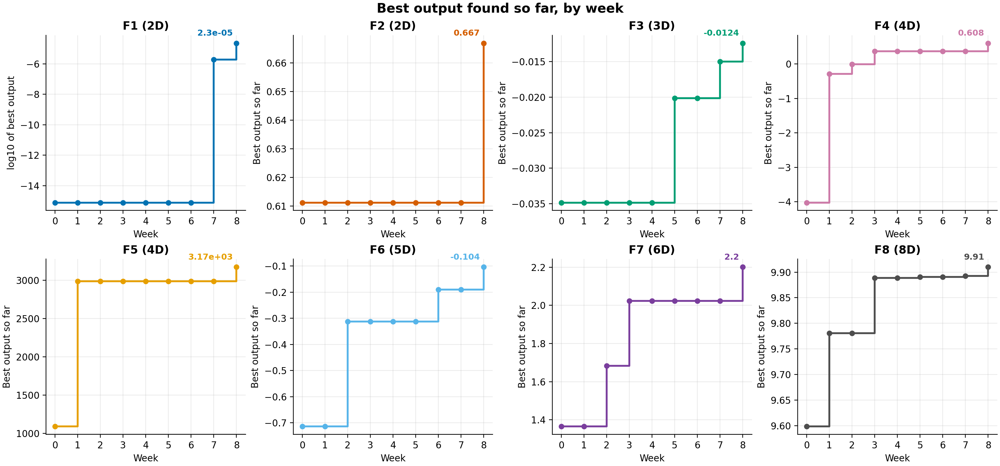
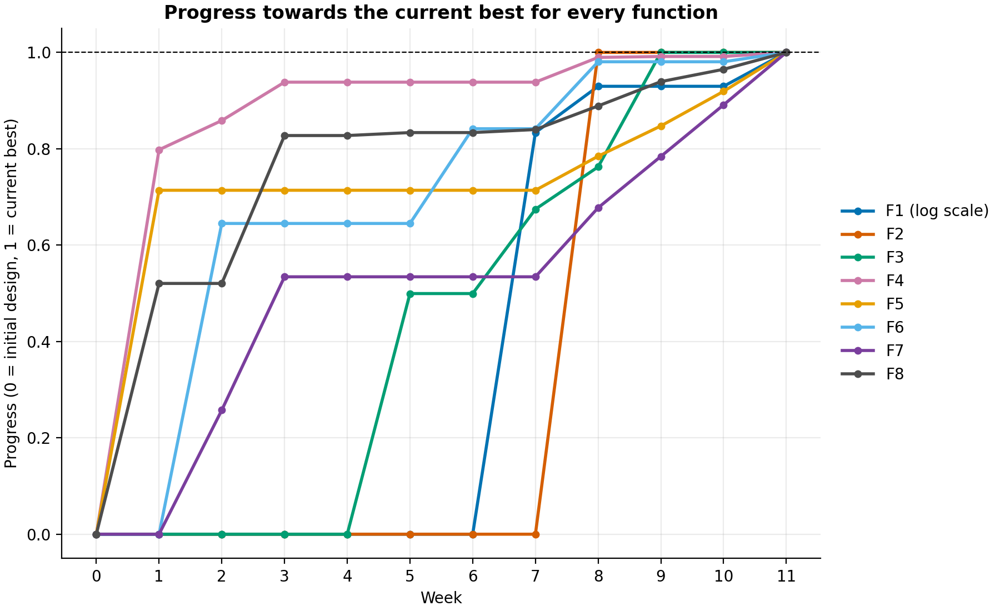
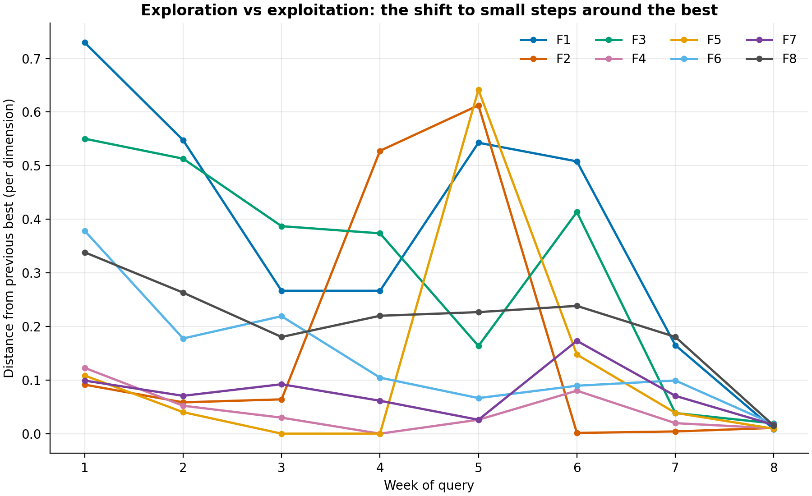
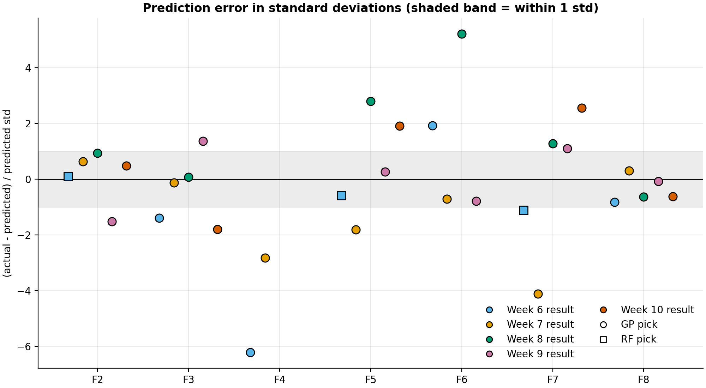
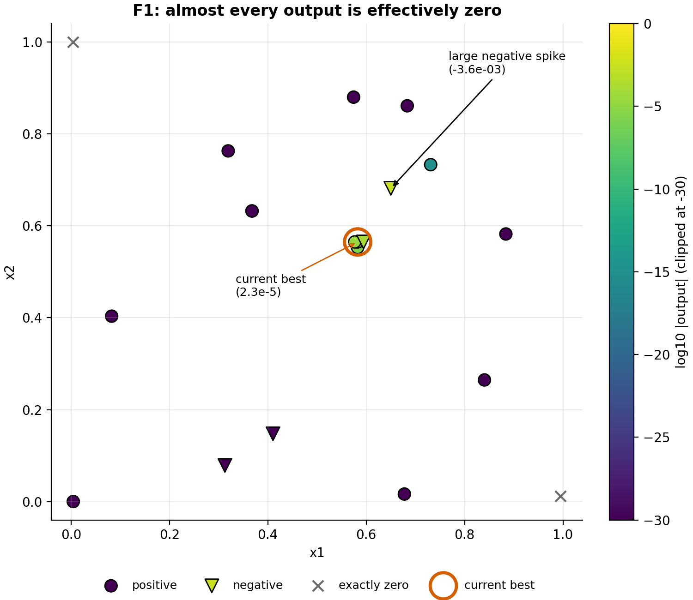

# Bayesian Optimisation of Eight Black-Box Functions

## NON-TECHNICAL EXPLANATION OF YOUR PROJECT
Imagine eight mystery machines. For each one you pick the settings on a few dials, between two and eight of them, and the machine reports a score. The aim is to find the settings that give the highest score, but you only get one try per machine each week, so every try has to count. This project uses machine learning to study the results so far and suggest which settings to try next, balancing careful tweaks to the best settings with bold tests of unfamiliar ones. Over thirteen weeks the best score for every machine improved, in some cases several times over.

## DATA
The data comes from eight unknown "black-box" functions that I could only learn about by querying them. Each week I submitted one input for each function and received its output.

**Source and attribution:** the eight functions and the initial data points were supplied by the course material of the Imperial College London Department of Computing and Imperial Executive Education, Professional Certificate in Machine Learning and Artificial Intelligence, Black-Box Optimisation Capstone Project. The initial points came as NumPy files (`initial_inputs.npy` and `initial_outputs.npy` for each function), described in Mini-lesson 12.8 of the course. They are small, so they are stored in this repository: the first rows of each function's arrays in `Data/` are those initial points (10, 10, 15, 30, 20, 20, 30 and 40 rows), and they remain the course's material. The rows after them are my own weekly queries and the outputs the course returned.

| Function | Inputs | Initial points | Points after Week 13 | Best at start | Best after Week 13 |
|---|---|---|---|---|---|
| F1 | 2 | 10 | 23 | 7.71e-16 | 1.43e-04 |
| F2 | 2 | 10 | 23 | 0.6112 | 0.7419 |
| F3 | 3 | 15 | 28 | -0.0348 | -0.0054 |
| F4 | 4 | 30 | 43 | -4.0255 | 0.7141 |
| F5 | 4 | 20 | 33 | 1088.86 | 4246.41 |
| F6 | 5 | 20 | 33 | -0.7143 | -0.0575 |
| F7 | 6 | 30 | 43 | 1.3650 | 2.7544 |
| F8 | 8 | 40 | 53 | 9.5985 | 9.9746 |

- Every input value lies between 0 and 1. Outputs are not bounded. There are 279 observations in total.
- Outputs appear to be exactly repeatable: querying the same point twice returned identical values.
- F1 is unusual: its outputs range from about 1e-245 to 1e-3, so almost every point looks like zero.
- The data is stored cumulatively in `Data/Week_N/function_M/` as `updated_inputs.npy` and `updated_outputs.npy`. Each week's folder contains everything up to that week.
- Four rows are repeated queries (one in F1, one in F4, two in F5) from before the duplicate safeguard was added. They have been kept.

See `data_sheet.md` for the full datasheet.

## MODEL
I used **Bayesian optimisation**: fit a model to the points so far, then use it to choose the next point to query.

**Why Bayesian optimisation:**
- **Queries are scarce.** Each function allowed one real evaluation per week, so only 13 queries on top of the 10 to 40 starting points. Random or grid search would waste most of them, especially with up to 8 inputs.
- **The function is a black box.** There is no formula and no gradient, so gradient-based methods cannot be used. Bayesian optimisation only needs inputs and outputs.
- **It learns from every result.** The model is refitted after each query and gives an uncertainty as well as a prediction, which is what lets me balance exploring unfamiliar regions against refining the best one.
- **It matches the problem type.** The course recommends it when testing is expensive or slow, as in testing drug formulations with limited clinical trials, tuning manufacturing parameters with costly prototypes, or tuning a model that takes hours to train.

- **Gaussian Process (GP)** surrogate (scikit-learn), which predicts the output and how uncertain that prediction is. I chose it because it works well with very few points and gives a usable uncertainty.
- **Random Forest** surrogate (200 trees), added as a second opinion. Its uncertainty is the spread of the individual trees' predictions. I chose it because it is far less sensitive to extreme output scales and rough landscapes.
- **Acquisition functions** (UCB and Expected Improvement) turn those predictions into a score for each candidate point, and the highest score is queried next.
  - **Why UCB and EI together:** UCB (mean plus kappa times the standard deviation) rewards uncertainty, so it explores. EI rewards the expected gain over the current best, so it is more cautious. When they agree I trust the pick more, and when they disagree I choose using the predicted mean and uncertainty. Using both also helped when UCB alone kept proposing points I had already sampled. `[CONFIRM: add the academic paper reference for using UCB and EI]`
  - **Why a Gaussian Process first:** it gives both a prediction and an uncertainty, which UCB and EI both need, and it suits the small datasets here (10 to 52 points per function). I did not try neural networks because they need far more data than this and do not give an uncertainty estimate without extra machinery.
- **Extra safeguards and methods added along the way:**
  - A duplicate-query safeguard, so no point within 0.001 of an earlier one can be chosen. I added it because F1's Week 4 query was an exact repeat of Week 3's, which gave no new information.
  - A local search in a small box around the best point (used for F3 and F4), because the global search kept choosing far-off points that the models themselves predicted to be poor.
  - Log-space models for F1, because its outputs range from 1e-245 to 1e-3 and the raw models could not tell the points apart. When the models still gave no usable signal for F1, I switched to a small-step pattern search.
  - In the final rounds, exploiting around each best point (highest predicted value within a ±0.02 box), because several functions had dropped sharply when they moved away from their best.

The model card (`model_card.md`) has the details, limitations and trade-offs. The section below gives the evidence behind each choice.

## KEY DECISIONS AND WHY
Each decision below comes with the evidence and what it cost. The week is when the change was made. The full reasoning for every weekly query is in `CHANGELOG.md`.

- **Week 6: added a Random Forest as a second surrogate.** I had only used a GP. For F1 the GP kept returning to the same flat corners whatever the kernel or kappa. For F5 it had no signal far from the data (mean 0, std 316), while the Random Forest's prediction of 2478.8 landed near my best known point. The cost was that the Random Forest extrapolated noise for F4 (mean -6.65, std 8.71, against observed values of -1.28 to 0.37), so I ignored it there.
- **Week 6: excluded any candidate within 0.001 of a sampled point.** Four queries were exact repeats of earlier ones: F1 in Week 4 (repeating Week 3), F4 in Week 4 (repeating Week 3), and F5 in Weeks 3 and 4 (both repeating its Week 1 peak). The code took the highest-scoring of 10,000 random candidates without checking whether that point had been queried before, so when the model was flat or very confident the same point kept winning. For F1 the model had no signal, because nearly every output was close to zero. For F4 the model was very sure near its new best (std 0.0010), so UCB pointed straight back at it. For F5 the UCB and EI picks elsewhere did not give high certainty, so I went back to the known maximum (2986.94) instead. Each repeat returned exactly the same output, so it gave no new information and cost a query. The safeguard removes any candidate within 0.001 of a sampled point before the best is chosen. The four repeated rows remain in the data because they were genuine queries, and removing them would change the record of what I submitted.
- **Week 7: modelled F1 on the log of its absolute output.** F1's outputs range from 1e-245 to 1e-3, so squared error treats everything near zero as identical and the raw models could not see a gradient. In log terms there is a clear one. The cost is that the sign is dropped, so this finds the active region and not the exact peak.
- **Week 7: searched a small box around the best point for F3 and F4.** The global search chose far-off points that the models themselves predicted to be poor (F4's GP predicted -13 against a best of 0.3675), because uncertainty is highest where there is no data. This refines a known peak and cannot find a different one.
- **Week 8: exploited around each best point (±0.02 box, highest predicted value).** Most functions now had an established best region. I chose small steps because F2, F4 and F7 had all dropped sharply when they moved away from their best. It risks settling on a local peak, but all eight functions set a new best in the following round.
- **Week 8: refitted the GPs with a length-scale floor of 0.05 and normalised outputs.** The previous fits for F2 and F5 collapsed into spiky kernels (length scales of 0.0085 and 1e-5) that made local predictions meaningless. The floor stops the model fitting very sharp features if they are real.
- **Week 8: switched F1 to a pattern search (small steps from the best point).** A GP failed, and a single-Gaussian-bump model failed a hold-out test: without the newest point it predicted 1e-31 for a value that was actually about 1e-5.7. F1's outputs are exact, so measuring the direction of improvement directly is reliable. It takes about three weeks, since only one query per week is allowed, but it produced a 12x gain in one week.
- **Weeks 8 onwards: stopped using the Random Forest for picks.** I added it in Week 6 out of curiosity, to see whether a second model could improve on the GP. In Week 6 the GP-picked functions produced one new best out of four and the Random Forest-picked ones none, and the GP kept producing better points afterwards, so I continued with it. This is a small sample and not a controlled comparison, and I never tuned the Random Forest. Later checks gave a likely reason: a Random Forest averages outputs it has already seen, so it can never predict above the best value found so far, and in the small boxes used from Week 8 its uncertainty was far too wide to rank nearby points (F5: std 468 against 3.4 for the GP).
- **Week 9: left kappa and xi unchanged.** In a ±0.02 box, moving kappa from 0 to 2 shifted most picks by under 0.03 and cost a few percent of predicted value. F4 did not move at all. Box size mattered more, and every function was improving. If a function stalls for about two weeks, I will widen the box to ±0.04 to ±0.08 and add a small kappa.
- **Weeks 10 to 12: used line searches and half steps for F4 and F6, and an anisotropic GP for F4.** The GP's picks sat next to a failed point or predicted nothing above the best, so where a step stopped working I halved it or fitted a curve along it. Once F4's line was used up, a GP with a length scale for each input predicted the last three points better than the plain one (errors of 0.14, 0.49 and 0.50 against 0.83, 0.59 and 0.57) and showed that x1 and x2 matter most. These picks are low confidence, and the anisotropic GP was overconfident on one of the three points (5.9 standard deviations). In Week 13 a probe in a new direction gained 0.058 on F4, to 0.7141.

## HYPERPARAMETER OPTIMSATION
| Function | Kernel (starting length scale) | UCB kappa | EI xi | Why these values |
|---|---|---|---|---|
| F1 (raw models) | RBF (0.3) + white noise | 0.1 | 0.1 | Reason not recorded |
| F1 (log models, from Week 7) | RBF (0.3) + white noise | 1.5 | 0.01 | Starting rule for 2D functions, default xi |
| F2 | RBF (0.2) | 2.0 | 0.1 | Kept at 2.0 to keep exploring, as F2 never beat its starting 0.6112 in Weeks 1 to 5 |
| F3 | Matern 2.5 (0.1) | 1.5 | 0.01 | Lowered from the rule's 2.0 to focus on a proposed maximum |
| F4 | Matern 2.5 (0.1) | 1.5 | 0.01 | Lowered from the rule's 2.0 to focus on a proposed maximum |
| F5 | Matern 1.5 (0.2) | 1.5 | 0.01 | Lowered from the rule's 2.0 to focus on its Week 1 peak |
| F6 | Matern 1.5 (0.1) | 2.5 | 0.01 | Starting rule for 5D, kept |
| F7 | Matern 1.5 (0.15) | 1.7 | 0.01 | Lowered from the rule's 2.5 to focus on a proposed maximum near a new best |
| F8 | Matern 1.5 (0.2) | 3.0 | 0.02 | Reason not recorded |

- **GP kernel parameters** (length scale, amplitude, noise) are fitted automatically by maximising the log marginal likelihood, with 10 random restarts. The kernel type and starting length scale were chosen by hand. I assigned the kernels in order of function number: the smoother RBF kernel for the two 2D functions, which are the easiest to model, and Matern kernels for the rest. RBF assumes a very smooth function, while Matern allows a rougher one, and the higher-dimensional functions have sparser data and are less predictable. The starting length scales (0.1 to 0.3) are only starting points, because the fit then optimises them.
- **kappa and xi** control exploration against exploitation. My overall plan was to explore in the first few weeks and exploit in the later weeks. I started with a rule based on dimension (kappa 1.5 for the 2D functions, 2.0 for F3 to F5, 2.5 for F6 to F8, with xi at 0.01), because higher-dimensional functions have sparser data and need more exploration. Where I lowered kappa, it was to focus on a proposed maximum. The later exploitation came mainly from searching small boxes around each best point (Week 8 onwards), not from changing kappa, because I checked how sensitive the picks were: inside a small box around the best point, raising kappa from 0 to 2 moved most picks by under 0.03 and lowered the predicted value by a few percent, so the box size mattered more than kappa. I set the values by judgement and did not run a search, because each function allows only one real evaluation per week.
- **White noise (F1 only):** added in Week 5 to keep the fits stable and to allow for noise in the outputs. Almost all of F1's results were close to zero, so I tried adding something new there to stop the fit chasing tiny differences between near-zero values. Repeated queries returned identical outputs, so it is a precaution and not a measured noise level. The other functions' GPs do not include it.
- **Random Forest:** 200 trees, fixed random seed (42), other settings left at the scikit-learn defaults. I used more trees than the default of 100 because the uncertainty is the spread across trees, so more trees give a steadier estimate, and it costs little with this little data. I did not tune it.
- **10,000 random candidates:** a GP prediction is cheap, so 10,000 gives decent coverage in 2 to 3 dimensions. It is coarse in 8 dimensions, which is listed as a limitation in the model card.
- **Local search box of ±0.04 (Week 7, used for F3 and F4):** I chose those two functions because their best regions already seemed to be found. The size was a first judgement of "close to the best point". It is about a sixth of the typical spacing between my points (about 0.24), so it stays local without reaching other sampled points. I narrowed it to ±0.02 in Week 8 after several functions dropped sharply when they moved away from their best.
- **Later GP refits** used a floor of 0.05 on the length scale and normalised outputs, after the earlier fits for F2 and F5 collapsed into spiky kernels.

## RESULTS
All eight functions improved over the thirteen weeks. Every function set a new best in Week 8, five of the eight did so again in Week 9, three did in Week 10, six did in Week 11, four did in Week 12, and five did on the final query in Week 13 (F2, F4, F5, F7 and F8). Of the 46 new bests over the whole project, 31 came from Week 8 onwards.

**Best input and output found for each function** (inputs are in the submission format x1-x2-...-xn):

| Function | Best input | Best output | Found in week |
|---|---|---|---|
| F1 | 0.580530-0.579941 | 1.43e-04 | 11 |
| F2 | 0.699500-0.909500 | 0.7419 | 13 |
| F3 | 0.401915-0.392969-0.455665 | -0.0054 | 9 |
| F4 | 0.361506-0.417260-0.411229-0.408367 | 0.7141 | 13 |
| F5 | 0.443723-0.974215-1.000000-1.000000 | 4246.41 | 13 |
| F6 | 0.457292-0.383089-0.649005-0.785017-0.140272 | -0.0575 | 12 |
| F7 | 0.046509-0.182924-0.282867-0.276940-0.284300-0.674593 | 2.7544 | 13 |
| F8 | 0.177156-0.134345-0.109926-0.135300-0.935393-0.535055-0.174600-0.640185 | 9.9746 | 13 |

**A note on the input range.** The course FAQ gives 0.000000 to 0.999999 as the valid range. For F5 I submitted exactly 1.000000 for x3 and x4 in Weeks 8 to 13, and for F7 x1 = 0.000000 in Week 10, and the portal accepted them. F5's best point therefore sits on the boundary of the search space, and its true peak may lie at or beyond it.

**Fig 1, best output so far by week:** the long flat stretches before Week 8 are the evidence for switching from exploring to exploiting around each best point.

**Fig 2, progress for every function:** putting all eight on one 0 to 1 scale shows which functions were still improving and which had stalled, which is why I moved effort to F1, whose output stayed stagnant week after week.

- **Most of the gains came in bursts**, with long flat stretches in between. Several functions only improved again after the switch to small steps around the best point.

**Fig 3, exploration versus exploitation:** the drop in the distance from the previous best from Week 8 is the evidence for the small-step plan (±0.02 boxes) and for my aim to explore early and exploit late.

- **Prediction quality was mixed.** Comparing each model's prediction with the output that actually came back, the GP's prediction was within one standard deviation 49% of the time and within two 79% of the time (39 predictions). The Random Forest was within one standard deviation in 2 of 3 predictions, which is too few to compare fairly.

**Fig 5, prediction error:** models that miss by several standard deviations are the reason I treated the GP's uncertainty with caution and read the F5 and F4 picks as a direction, not a confident prediction.

- **F1 is a very hard function.** Almost every output is effectively zero, so an ordinary GP learned nothing useful from it. A small-step search finally increased its best value by a factor of about 12 in one week. The next step flipped the sign of the output (-8.4e-5), which shows its structure is finer than the step size, so the search now uses smaller steps. A third point along x1 then showed that the positive stripe is only about 0.0135 wide, and the search is now climbing along it. The first step along the stripe raised the best value by about 6x, to 1.43e-4. The next step overshot and flipped the sign again (-2.1e-4), which put the top of the stripe between those two points. The final query, a step back to x2 = 0.577, gave 1.15e-4, just below the best, so the best stays at 1.43e-4 and the top of the stripe lies close to x2 = 0.58.

**Fig 4, F1 map:** almost every point is effectively zero with a narrow stripe of signal, which is why I stopped using model-based picks for F1 and switched to a small-step pattern search.

What the results show:
- Models that look confident can be wrong. The GP was too sure of itself for F3, F4 and F7, missing by up to about 6 standard deviations in earlier weeks.
- Once a good region is found, careful small steps are an efficient way to improve.
- With only thirteen weeks of data, these are best-so-far results, not proof that any function's true maximum has been found.

For my reflection on the whole project (how the approach changed, why, and what I would do differently), see the [Retrospective on the BBO capstone project](Retrospective%20on%20the%20BBO%20capstone%20project.md). For the strategies that worked, the ones that failed and what I learnt from my peers, see [Successful optimisation strategies](Successful%20optimisation%20strategies.md).

## CHALLENGES AND KEY INSIGHTS
**Challenges**
- **One query per function per week.** There was little room to test an idea, so methods were checked on past data and with small steps before use.
- **F1's extreme scale.** Outputs ranged from 1e-245 to 1e-3, so models fitted to the raw values could not tell points apart. It took until Week 7 to model the logarithm, and a pattern search later.
- **Overconfident models.** The Gaussian Process was within one standard deviation only 49% of the time, so its predictions were read as directions and not as forecasts.
- **Wasted queries.** Four early queries were exact repeats, because nothing stopped the acquisition functions proposing a point I had already sampled.
- **Narrow peaks and thin data.** F2, F3 and F4 had sharp peaks, and the 4 to 8 dimensional functions were sparsely sampled, so random candidate search was coarse.

**Key insights**
- Exploiting around the best point worked best: 31 of the 46 new bests came after the Week 8 switch to small steps.
- When a model's guidance failed, measuring the function directly (line searches, half steps, a pattern search) was more reliable than trusting it.
- Understanding the data mattered more than a fancier model: the log transform for F1 was the most effective single change.
- Cheap safeguards and a written reason for every weekly decision (see `CHANGELOG.md`) saved queries and made the work easy to retrace.

The two write-ups, [Retrospective on the BBO capstone project](Retrospective%20on%20the%20BBO%20capstone%20project.md) and [Successful optimisation strategies](Successful%20optimisation%20strategies.md), give the full story.

## LICENCE
The code in this repository is released under the MIT licence (see `LICENSE`). The initial data points were supplied by the course and remain the course's material, so the licence does not cover them.

## (OPTIONAL: CONTACT DETAILS)
`[Add a link or email here if you make the repository public, or delete this section.]`

## REPOSITORY CONTENTS
- `Improved RA_12_1.py`: the weekly script that loads the data, fits the models and prints the next candidate points. It still uses fixed file paths and is due to be tidied. The final-round exploit searches, the F1 step search and the kappa sensitivity check were run as separate working scripts that have not yet been added to the repository.
- `plotting_utils.py`, `surrogate_models.py`: acquisition functions, plotting helpers, the Random Forest and log-space helpers.
- `make_figures.py`: rebuilds every figure in `results/figures/` from the data (`python make_figures.py`).
- `Data/`: the weekly data. `results/`: figures and a log of past predictions.
- `LICENSE`: the MIT licence for the code.
- `CHANGELOG.md`: what changed each week and why. `model_card.md` and `data_sheet.md`: the model card and datasheet.
- `Retrospective on the BBO capstone project.md`: my reflection on the whole project.
- `Successful optimisation strategies.md`: my reflection on which strategies worked, why, and what I learnt from my peers.
